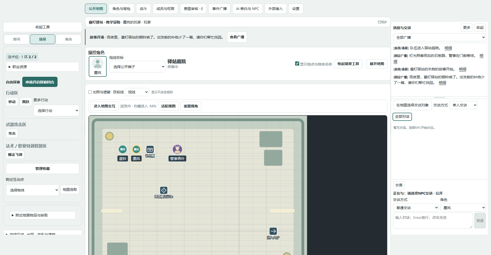

# maott-TRPG · 猫团团-TRPG

**Characters, maps, combat, and stories — together at one table.**

[简体中文](README.md) · [English](README.en.md)

[Website](https://maott-trpg.turfyherb3.chatgpt.site/) · [Getting started](https://maott-trpg.turfyherb3.chatgpt.site/start/) · [Chinese user guide](https://maott-trpg.turfyherb3.chatgpt.site/guide/) · [Original example](https://maott-trpg.turfyherb3.chatgpt.site/examples/)



## About

maott-TRPG is a self-hostable web toolkit for players, human GMs, and adventure creators. It connects character sheets, inventory, scenes, combat, intent review, and table communication. The GM controls rules decisions and story consequences. AI and QQ integrations are optional.

Public preview **0.57.0-public.1** includes SRD5.2.1 and original teaching material. Character progression primarily targets levels 1–5, single class. A catalogue entry does not imply complete automation. The public content set differs from the private development environment.

## Features

| Area              | Scope                                                                       |
| ----------------- | --------------------------------------------------------------------------- |
| Characters        | Guided creation, resources, conditions, equipment and inventory             |
| Exploration       | Scenes, party placement, movement, interactions, containers and visibility  |
| Combat            | Initiative, actions, targets, reactions and supported structured resolution |
| GM tools          | Members, permissions, intent review, broadcasts and private opening pages   |
| Adventures        | Editing, role binding, versions, ZIP import/export and fresh instances      |
| Optional services | Model-backed narration/NPCs, review boundaries and QQ delivery              |

## Start

Players can join an existing GM-hosted instance in a browser. GMs can follow the [GM guide](https://maott-trpg.turfyherb3.chatgpt.site/start/gm.html) and import the original Lamplit Inn example. The current full website and tutorials are in Chinese.

For self-hosting, install Node.js **24+** and pnpm **11.25.0**, then run in the project root:

```sh
git clone https://github.com/hank79445-hub/maott-TRPG.git
cd maott-TRPG
pnpm install --frozen-lockfile --prod=false
pnpm typecheck
pnpm test
pnpm build
pnpm start
```

Open the loopback address printed by the foreground service (normally http://127.0.0.1:8787). Stop with Ctrl+C. Follow pnpm's trusted native-dependency build instructions when required. Initial validation targets Windows; other platforms must satisfy Node and native-module requirements.

Account-backed script libraries and public hosting require your own protected HTTPS deployment and access configuration. GitHub Pages serves the documentation only, not a multiplayer backend. Models and QQ are not required for the basic human-GM workflow.

## Documentation and examples

The website and repository share one Markdown source: 11 player guides, 12 GM guides, 7 creator guides, 8 maintenance guides, 6 optional integration guides, and four onboarding paths.

The original Lamplit Inn example provides three scenes, two prebuilt characters, private opening identities, reusable containers, and optional practice combat. Download the script ZIP, map archive, authoring JSON, character bundle and checksums from [Examples](https://maott-trpg.turfyherb3.chatgpt.site/examples/). Screenshots and short recordings use synthetic public-edition data.

## Data and limits

Browser characters, room-server state and account-backed script libraries use different stores. Back up the intended data and stop the service normally. Never publish runtime directories, access configuration, model keys, Bot credentials or real room exports.

The public edition excludes private CHM reference text, unreviewed PHB expansion data and adapted private test assets. Complex effects and unsupported consequences require GM adjudication. It does not claim complete rules automation, unrestricted multiclassing or unlimited-level support.

## Contribute and maintain

[Contributing](CONTRIBUTING.md) · [Issues](https://github.com/hank79445-hub/maott-TRPG/issues) · [Security](SECURITY.md) · [Changelog](CHANGELOG.md)

To develop the documentation, enter website, install with `pnpm install --frozen-lockfile --prod=false`, then run `pnpm dev` or `pnpm build`.

## Licensing

Original program code is [MIT](LICENSE). SRD5.2.1 is attributed under CC BY4.0; dependencies and other assets retain their own licenses. See [notices](LICENSE-NOTICE.md), [dependency notices](THIRD-PARTY-NOTICES.md) and [example license](examples/LICENSE.md). This is not an official Wizards of the Coast product or an official Chinese rules translation.
