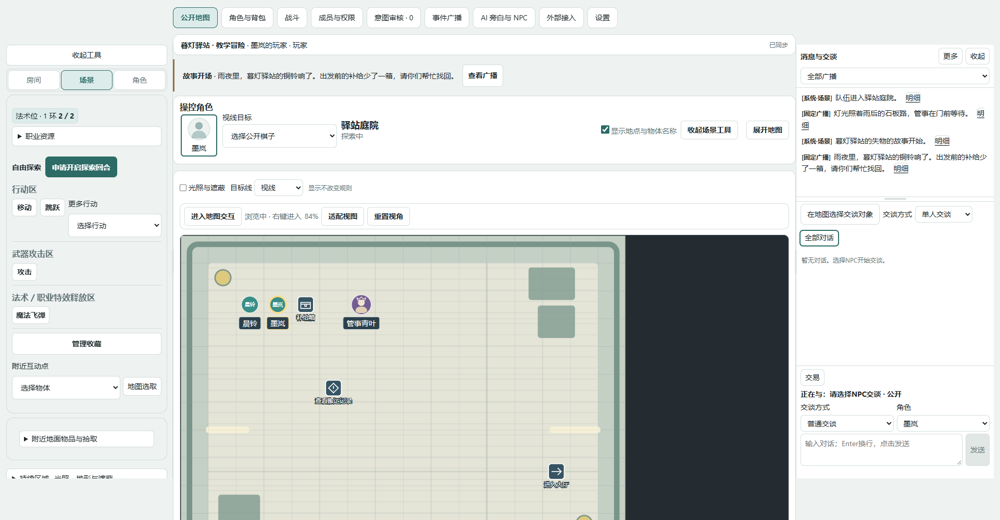

# 猫团团-TRPG · maott-TRPG

**把角色、地图、战斗与故事，放在同一张桌上。**

[简体中文](README.md) · [English](README.en.md)

[项目介绍](https://maott1.cn/) · [快速上手](https://maott1.cn/start/) · [完整教程](https://maott1.cn/guide/) · [原创示例](https://maott1.cn/examples/) · [支持范围](https://maott1.cn/about/status.html)



## 这是什么

猫团团-TRPG是一款可自行部署的网页跑团工具，为玩家、真人GM与剧本创作者连接角色、背包、场景、战斗、审核与消息。你管理自己的环境和数据，按需接入模型或QQ，GM保留规则与剧情后果的最终决定。

公共预览版 **0.57.0-public.1**：默认资料为SRD5.2.1与项目原创教学内容。目录存在不代表全部规则效果自动化；角色成长主要覆盖1–5级单职业。完整开发版与公共版的资料范围有区别。

## 适合谁

- 玩家：加入已有房间、获得角色控制，在地图上行动并跟进结果。
- GM：准备场景、邀请和分配、审核请求、主持战斗与广播。
- 创作者：组织场景、NPC与条件，保存版本并复用剧本。
- 部署者：运行自己的服务，维护访问、账号、备份与更新。

## 功能总览

| 功能        | 内容                                       | 教程                                                                                     |
| ----------- | ------------------------------------------ | ---------------------------------------------------------------------------------------- |
| 角色与背包  | 七步建卡、资源、状态、库存与穿戴           | [玩家指南](https://maott1.cn/guide/player/character-sheet.html) |
| 场景与探索  | 地图、队伍、移动、互动、容器取放与可见性   | [地图行动](https://maott1.cn/guide/player/explore.html)         |
| 战斗        | 名单、先攻、行动、目标、反应与已支持结算   | [战斗入门](https://maott1.cn/guide/player/combat.html)          |
| GM协作      | 成员权限、意图审核、事件广播、个人开场阅读 | [GM路径](https://maott1.cn/start/gm.html)                       |
| 剧本        | 编辑、角色位、版本、ZIP导入导出、新实例    | [创作路径](https://maott1.cn/start/creator.html)                |
| 可选AI／NPC | 旁白、知识记忆、对话与明确审批边界         | [可选接入](https://maott1.cn/guide/advanced/models.html)        |
| 维护与接入  | 本机／同网／HTTPS实例、数据、可选QQ        | [部署教程](https://maott1.cn/deploy/requirements.html)          |

## 快速开始


**已有GM的玩家**：[加入房间](https://maott1.cn/start/player.html)，无需在自己的电脑安装后端。

**第一次开团的GM**：[导入原创示例](https://maott1.cn/examples/)，邀请、分配、保存队伍并入场，再启动开场阅读。

**自行部署**：安装Node.js **24+**与pnpm **11.25.0**，在项目根目录执行：

```sh
git clone https://github.com/hank79445-hub/maott-TRPG.git
cd maott-TRPG
pnpm install --frozen-lockfile --prod=false
pnpm typecheck
pnpm test
pnpm build
pnpm start
```

打开终端显示的本机地址，通常为 `http://127.0.0.1:8787`。服务在前台运行，按Ctrl+C正常关闭。原生依赖需要构建时，按pnpm提示为本项目可信依赖启用构建并重新安装。首发主要在Windows验证；其他平台需满足Node、Sharp与可选SQLite依赖要求。

本机基础房间不要求模型。账号个人库和公网实例另需自己的HTTPS反向代理及访问配置，见[受保护部署](https://maott1.cn/deploy/public-config.html)。GitHub Pages仅运行介绍站，不运行房间服务。

## 完整文档

- [玩家11篇](website/guide/player/join.md)
- [GM12篇](website/guide/gm/prepare.md)
- [创作者7篇](website/guide/creator/new-script.md)
- [部署维护8篇](website/deploy/requirements.md)
- [可选进阶6篇](website/guide/advanced/models.md)
- [故障与常见问题](website/help/index.md)

网站与GitHub使用同一套Markdown正文，详细教程不另复制一份。截图与短动图使用公共版合成场景。

## 原创示例

《暮灯驿站的失物》包含三处场景、两个预制角色、独立身份、可重复容器与可选切磋。提供剧本ZIP、本机冒险JSON、作者格式、角色包及校验清单，详见[下载与步骤](https://maott1.cn/examples/)。模型与QQ默认不需要配置。

## 数据与支持边界

浏览器角色、服务端房间与账号剧本库分别保存。源码仓库不包含你的运行数据；备份前查清范围并正常关闭服务。不要把 `.local`、账号配置、真实房间、模型密钥或Bot凭据推到公开仓库。

公共版不携带个人阅读CHM译文、未核验PHB扩展资料或作者的私测改编包。复杂效果与故事后果保留GM裁定，未提供的数据卡不会被虚构补齐。

## 开发与贡献

[贡献指南](CONTRIBUTING.md) · [反馈问题](https://github.com/hank79445-hub/maott-TRPG/issues) · [安全反馈说明](SECURITY.md) · [更新记录](CHANGELOG.md)

网站开发：进入website目录，执行 `pnpm install --frozen-lockfile --prod=false`、`pnpm dev`；正式构建为 `pnpm build`。

## 许可与来源

原创程序按[MIT](LICENSE)提供。SRD5.2.1按CC BY4.0署名；第三方依赖与素材各自适用其许可。请阅读[来源说明](LICENSE-NOTICE.md)、[依赖通知](THIRD-PARTY-NOTICES.md)和[示例许可](examples/LICENSE.md)。

项目不是Wizards of the Coast的官方产品，中文界面不是官方中文规则译本。
